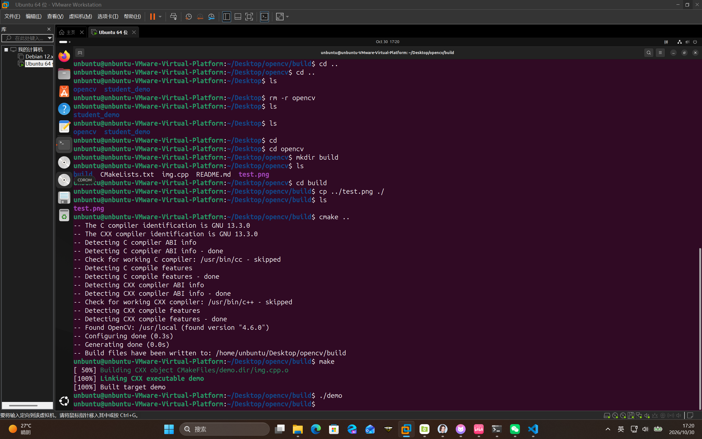

# opencv_demo —— 读取并显示图片

智能科学与技术　04252222　范东颖

用 OpenCV 的 C++ 接口读取一张本地图片并在窗口中显示，工程由 CMake 管理，通过 `find_package(OpenCV)` 查找并链接 OpenCV。

## 目录结构

```
opencv_demo/
├── CMakeLists.txt   # CMake 构建脚本
├── img.cpp          # 源码：imread 读图 + imshow 显示
├── test.png         # 测试图片
└── README.md        # 本文件
```

## 开发环境

| 项目 | 版本 |
| --- | --- |
| 操作系统 | Windows 11 x64 |
| 编译器 | MSVC（Visual Studio 2022） |
| CMake | ≥ 3.10 |
| OpenCV | 4.13.0 |

## 编译

OpenCV 是外部依赖，编译前需要让 CMake 找到它的 `OpenCVConfig.cmake`，用 `-DOpenCV_DIR=...` 指定 OpenCV 安装目录下的 `build` 路径（按自己电脑的实际位置修改）。

```bat
cd opencv_demo
cmake -S . -B build -DOpenCV_DIR="D:/opencv/build"
cmake --build build --config Release
```

编译成功后生成可执行文件：`build/Release/demo.exe`（单配置生成器则为 `build/demo.exe`）。

## 运行

`img.cpp` 中使用的是相对路径 `imread("test.png")`，程序会在**当前工作目录**里找图片，因此需要把 `test.png` 和可执行文件放在同一目录，或从图片所在目录启动程序：

```bat
copy test.png build\Release\
cd build\Release
demo.exe
```

运行后弹出一个标题为 `Image` 的窗口，显示 `test.png` 的内容，按任意键关闭窗口。

## 运行结果



程序运行后弹出一个标题为 `Image` 的窗口，窗口中显示 `test.png` 的内容；按任意键后窗口关闭，程序正常退出（返回码 0）。

## 主要代码说明

```cpp
#include <opencv2/opencv.hpp>
using namespace cv;

int main()
{
    Mat img = imread("test.png");   // 读取图片到 Mat（内存矩阵）
    if (img.empty())                // 读取失败（路径错误/格式不支持）时返回空矩阵
    {
        printf("图片读取失败，请检查 test.png 是否在当前工作目录\n");
        return -1;
    }
    imshow("Image", img);           // 在名为 Image 的窗口中显示
    waitKey(0);                     // 等待按键，保持窗口不关闭
    destroyAllWindows();            // 释放窗口资源
    return 0;
}
```

## 常见问题

- **报找不到 OpenCV**：`OpenCV_DIR` 没指对，或安装的 OpenCV 与编译器位数不一致（x64 程序必须用 x64 的 OpenCV）。
- **窗口一闪而过**：检查 `imshow` 之后是否有 `waitKey(0)`。
- **图片读取失败**：`imread` 用的是相对路径，工作目录不是图片所在目录时读不到；可先用绝对路径测试。
