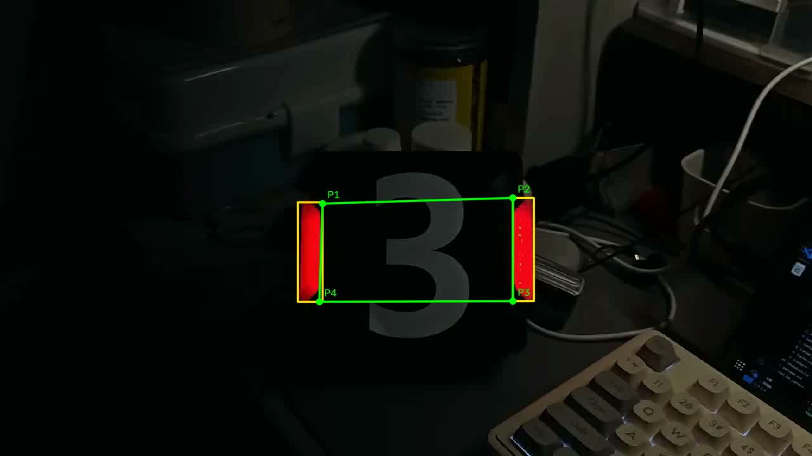

# 灯条和装甲板角点

程序逐帧读取 `assets/test_clip.mp4`，提取红色区域，按灯条长宽和方向筛掉零碎轮廓，再挑一对几何关系合适的灯条。黄色框标灯条，绿色连线和 P1–P4 标出装甲板外侧四个角点。

结果帧：



在这个文件夹里用命令行编译和运行：

```bash
cmake -S . -B build
cmake --build build
./build/detect_demo
```

结果默认写到 `outputs/detection.mp4`。需要边处理边看窗口时加 `--show`；按 Esc 退出。也可以用 `--video` 和 `--out` 指定输入、输出路径。

测试素材是从桌面提供的视频转成 H.264 的短片段，便于在常见 OpenCV/FFmpeg 环境里解码。编译输出目录和处理结果目录不会提交。
