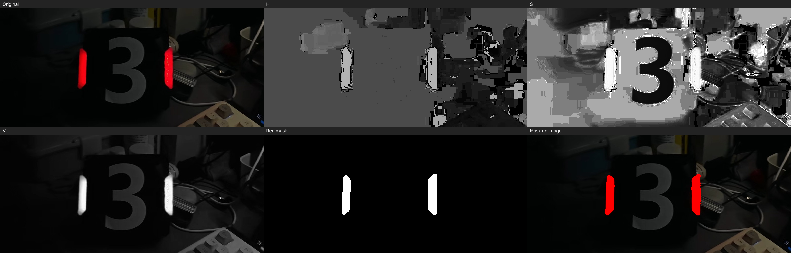

# HSV 通道与红色掩膜

读取 `assets/armor.jpg`，显示 HSV 的 H、S、V 三个通道，用 `inRange` 提取红色区域，并保存 `red_mask.png`。`task1_result.png` 是方便查看的结果拼图。

结果图：




在这个文件夹里用命令行编译和运行：

```bash
cmake -S . -B build
cmake --build build
./build/hsv_demo
```

需要弹出 H、S、V 和掩膜窗口时运行：

```bash
./build/hsv_demo --show
```

程序把 H 设为 `[0, 10]` 或 `[170, 180]`，并要求 S 至少为 100、V 至少为 70。红色在 HSV 色相环两端各有一段，所以两次 `inRange` 的结果合并后再做一次 3×3 闭运算。
