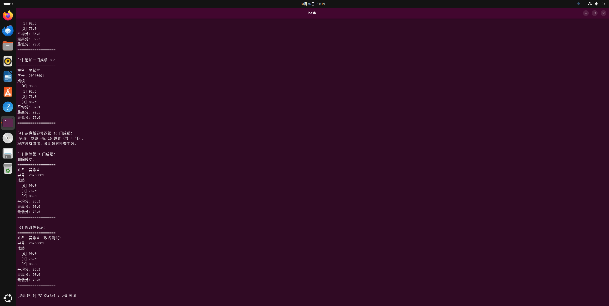
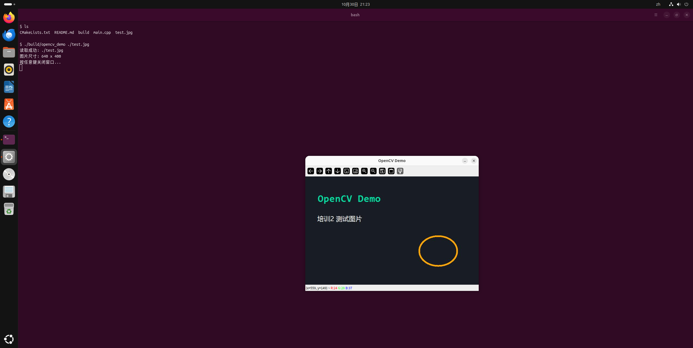

# 培训2 · 作业提交

本目录包含培训 2 的两个作业：

| 目录 | 内容 |
|---|---|
| `student_demo/` | `Student` 类：信息打印、成绩修改；分文件组织，CMake 构建，打包成静态库后链接 |
| `opencv_demo/` | OpenCV 读取并显示图片；CMake + `find_package` 查找 OpenCV 并链接 |

两个工程都**只用命令行编译运行**。

## 运行环境

| 项 | 版本 |
|---|---|
| 系统 | Ubuntu 26.04.1 LTS（VMware 虚拟机） |
| g++ | 15.2.0 |
| CMake | 4.2.3 |
| OpenCV | 4.10.0（`libopencv-dev`） |

## 编译运行（命令行）

### student_demo

在**仓库根目录**下执行：

```bash
cd "26智能制造吴希言/培训2/student_demo"
cmake -S . -B build
cmake --build build
./build/student_demo
```

产物：
- `build/libstudent.a` —— Student 的静态库（69 KB）
- `build/student_demo` —— 链接了该静态库的可执行文件

### opencv_demo

```bash
cd "26智能制造吴希言/培训2/opencv_demo"
cmake -S . -B build
cmake --build build
./build/opencv_demo ./test.jpg
```

`find_package` 的实测输出：

```
-- Found OpenCV: /usr (found version "4.10.0")
-- 找到 OpenCV 版本: 4.10.0
-- OpenCV 头文件目录: /usr/include/opencv4
```

## 环境依赖安装

```bash
sudo apt update
sudo apt install -y build-essential cmake pkg-config libopencv-dev
```

## 注意事项

1. **opencv_demo 必须在图形桌面里运行**
   通过 ssh 或纯字符终端跑会报 `cannot open display`。

2. **Linux 下可执行文件没有 `.exe` 后缀**
   运行用 `./build/student_demo`，不是 `student_demo.exe`。

3. **opencv_demo 可能出现一行 Qt 警告**
   `QSocketNotifier: Can only be used with threads started with QThread`
   这是 Wayland 会话下 OpenCV 使用 Qt5 后端的已知警告，不影响窗口显示，可以忽略。

## 运行结果（2026-10-30 实测）

| 项目 | 结果 |
|---|---|
| student_demo 编译 | ✅ 生成 `libstudent.a`（69 KB）+ `student_demo`（49 KB） |
| student_demo 运行 | ✅ 退出码 0，六段输出正确 |
| 静态链接验证 | ✅ 删掉 `libstudent.a` 后程序仍能运行 |
| opencv_demo 编译 | ✅ `Found OpenCV: /usr (found version "4.10.0")` |
| opencv_demo 读图 | ✅ `test.jpg` → 640×400，3 通道 |
| opencv_demo 显示 | ✅ 窗口弹出并等待按键（6 秒超时验证，进程仍在运行） |

### student_demo 运行截图



### opencv_demo 运行截图



各工程的详细说明见各自目录下的 `README.md`。
