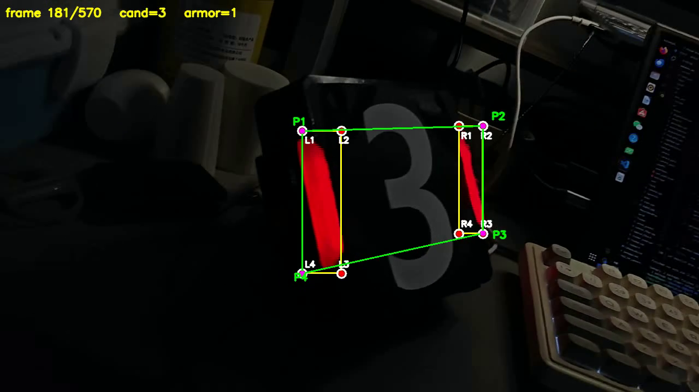

# 培训3 · OpenCV 装甲板识别

征途视觉组培训第三周作业，两个工程：

| 目录 | 内容 |
|---|---|
| `hsv_demo/` | 任务1：HSV 通道分离 + 红色掩膜 |
| `detect_demo/` | 任务2：视频里识别灯条和装甲板 |
| `shots/` | 运行效果截图 |
| `演示视频.zip` | 21 秒，1280×720：前 2 秒任务1 的 H/S/V 五窗口，后 19 秒任务2 识别效果 |

环境：Ubuntu 26.04 · g++ 15.2.0 · CMake 4.2.3 · **OpenCV 4.10.0**

---

## 任务1 · hsv_demo

### 做了什么

1. 读取装甲板图片 `armor.jpg`
2. 转成 HSV
3. 分离 H / S / V 三个通道，**分别弹出三个窗口**展示
4. 用 `inRange` 提取红色装甲的二值掩膜
5. 保存为 `red_mask.png`

### 编译运行

```bash
cd hsv_demo
cmake -S . -B build && cmake --build build -j

./build/hsv_demo            # 处理并保存掩膜（不弹窗）
./build/hsv_demo --show     # 弹窗看效果，按任意键关闭
./build/hsv_demo --record   # 同 --show，但把 5 个窗口缩排成 2 行，方便录演示视频
```

> `--record` 是专门为录屏加的：把每个窗口缩到 400×225 再按网格摆好，
> 这样一屏能同时看到 H / S / V / 掩膜 / 叠加，不用来回切窗口。

### 关键点

**红色在 HSV 里跨 0 度**，所以要两段区间取并集：

```cpp
const cv::Scalar kRedLower1(0,   100, 60);
const cv::Scalar kRedUpper1(10,  255, 255);
const cv::Scalar kRedLower2(160, 100, 60);
const cv::Scalar kRedUpper2(179, 255, 255);
```

OpenCV 的 H 范围是 **0~179**（不是 0~360），360 度对应 180。

**H 通道要拉伸**才能看出来，否则几乎全黑：

```cpp
cv::normalize(channels[0], out, 0, 255, cv::NORM_MINMAX);
```

形态学两步：开运算去噪点，闭运算补灯条内部空洞。

### 效果


---

## 任务2 · detect_demo

### 做了什么

1. 读视频 `test_clip.mp4`（19 秒，570 帧）
2. 转 HSV，用两段红色区间提取红色
3. `findContours` 找轮廓 → `minAreaRect` 框住灯条 → 按面积/长宽比/倾角过滤
4. 灯条两两配对成装甲板
5. 画出：
   - **黄色** = 灯条的外接矩形
   - **红点** = 灯条的四个角点
   - **P1~P4** = 装甲板的四个角点
   - **绿色** = 装甲板四边形连线

### 编译运行

```bash
cd detect_demo
cmake -S . -B build && cmake --build build -j

./build/detect_demo                      # 处理并保存结果视频
./build/detect_demo --show               # 弹窗实时看（空格暂停，q/ESC 退出）
./build/detect_demo out.mp4 --show       # 指定输出文件名
```

### 关键点

**不要用灰度阈值找灯条。** 一开始我用的是灰度二值化（阈值 180），
在这段暗光视频上**570 帧只识别出 0 帧**——因为红色灯条转灰度后亮度只有 70 左右，
根本过不了阈值。改成 HSV 红色掩膜后立刻正常。

**四个角点的排序方法**（对倾斜矩形也有效）：

- `x + y` 最小 = 左上（tl），最大 = 右下（br）
- `y - x` 最小 = 右上（tr），最大 = 左下（bl）

**装甲板四点**取两灯条的**外侧四角**，正好包住整块装甲板：

```
左灯条 tl → 右灯条 tr → 右灯条 br → 左灯条 bl
```

### 灯条筛选参数

| 参数 | 值 | 说明 |
|---|---|---|
| `kMinArea` | 30 | 轮廓最小面积 |
| `kMinAspect` | 1.8 | 长边/短边 最小比值 |
| `kMaxAngle` | 45° | 与竖直方向最大夹角 |
| `kMaxAngleDiff` | 12° | 两灯条角度差上限 |
| `kMaxHeightRatio` | 1.8 | 两灯条长度比上限 |
| `kMinGapRatio` | 1.2 | 两灯条中心距 / 灯条高 下限 |
| `kMaxGapRatio` | 5.0 | 上限 |

### 效果



### 实测结果

```
[信息] 视频 1280x720 @ 30fps，共 570 帧
[统计] 共 570 帧，其中 551 帧识别到装甲板（96.6667%）
```

没识别到的 19 帧集中在第 188~199 帧，是装甲板倾斜到接近侧视的角度，
两根灯条在画面上的间距被压得很小，达不到配对下限。属于正常情况。

---

## 关于相对路径

两个工程默认在**工程目录**里找 `armor.jpg` / `test_clip.mp4`。
如果要在 `build/` 目录里直接运行，CMakeLists.txt 已经把素材拷进去了：

```cmake
file(COPY ${CMAKE_CURRENT_SOURCE_DIR}/armor.jpg DESTINATION ${CMAKE_CURRENT_BINARY_DIR})
```

也可以命令行传路径：

```bash
./build/hsv_demo /path/to/other.jpg
```

---

## 提交前自检

- [x] 目录是 `26智能制造吴希言/培训3/工程名/`，没有在仓库根目录建文件夹
- [x] 所有 `CMakeLists.txt` 拼写正确（大写 C、M、L）
- [x] 测试图片 / 视频已放进工程目录
- [x] 演示视频打包成 `演示视频.zip`，4.0 MB < 100 MB
- [x] 没有 `build/`、可执行文件、`.vscode/`
- [x] 没改根目录的 `README.md` 和 `.gitignore`
- [x] 在全新目录里 `cmake -S . -B build && cmake --build build` 能成功
- [x] 能通过命令行运行出结果
