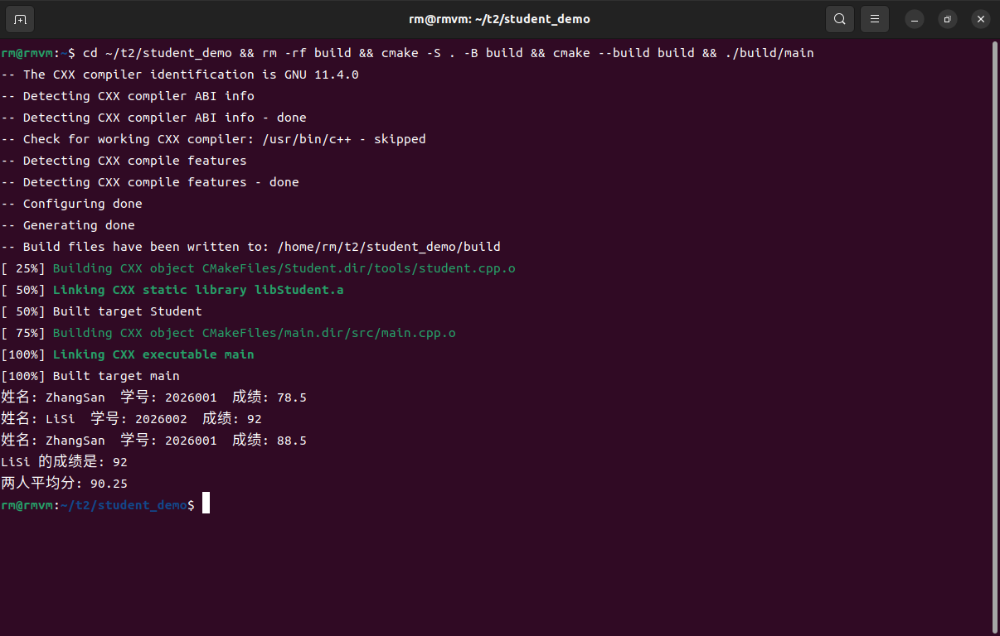
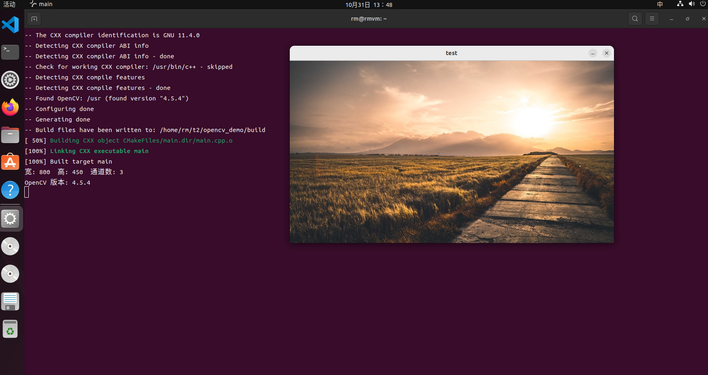

# 培训2

Ubuntu 22.04，全部用命令行编译运行。

## student_demo

Student 类存姓名、学号、成绩，能打印信息、能改成绩。
`tools/student.cpp` 编成静态库 `libStudent.a`，`src/main.cpp` 链接它。

```bash
cd student_demo
cmake -S . -B build
cmake --build build
./build/main
```

```
姓名: ZhangSan  学号: 2026001  成绩: 78.5
姓名: LiSi  学号: 2026002  成绩: 92
姓名: ZhangSan  学号: 2026001  成绩: 88.5
LiSi 的成绩是: 92
两人平均分: 90.25
```

编译时会看到 `Linking CXX static library libStudent.a`，说明静态库生成了。



## opencv_demo

读一张图显示出来，CMake 里用 find_package 找 OpenCV。

```bash
cd opencv_demo
cmake -S . -B build
cmake --build build
./build/main test.jpg
```

```
宽: 800  高: 450  通道数: 3
OpenCV 版本: 4.5.4
```

然后弹窗口显示图片，按任意键关闭。


