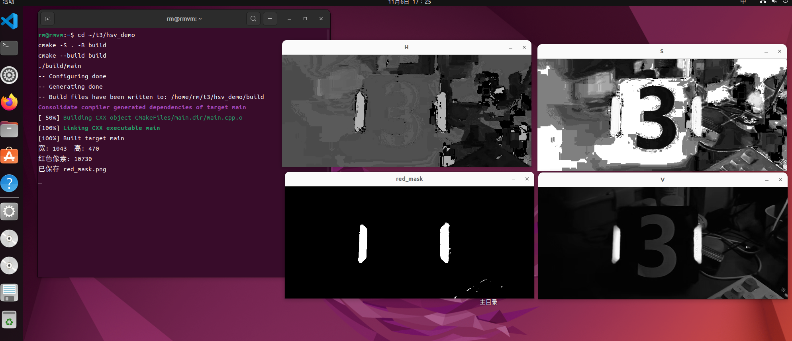
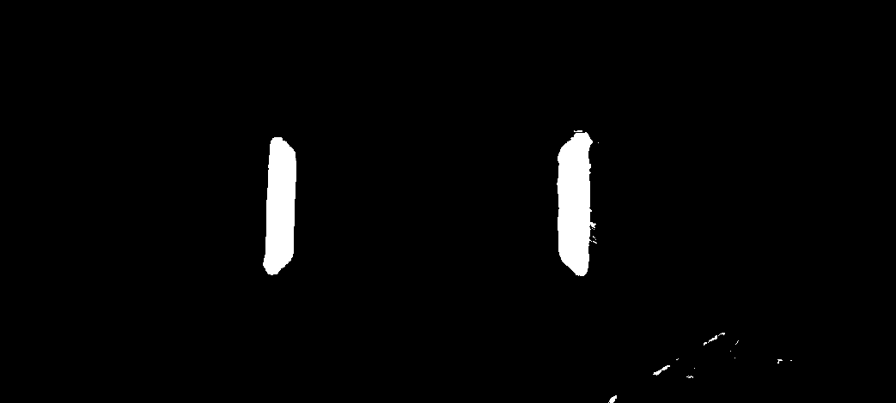
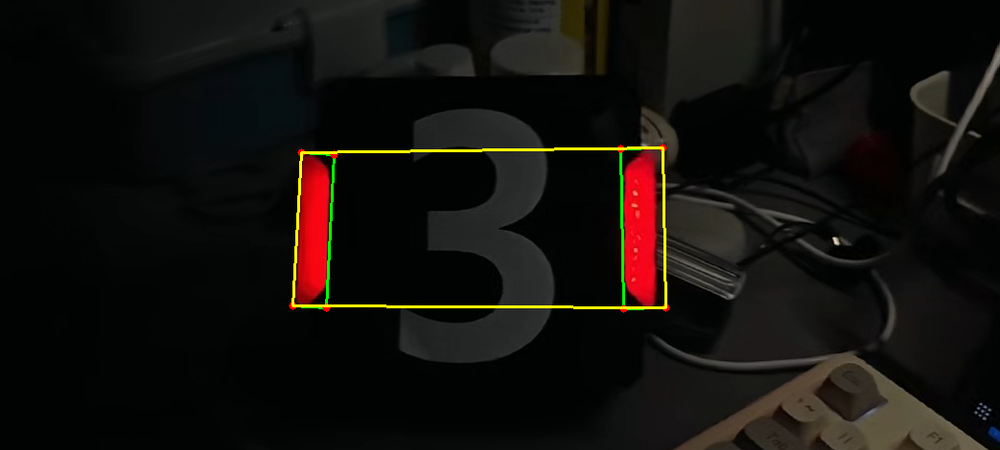
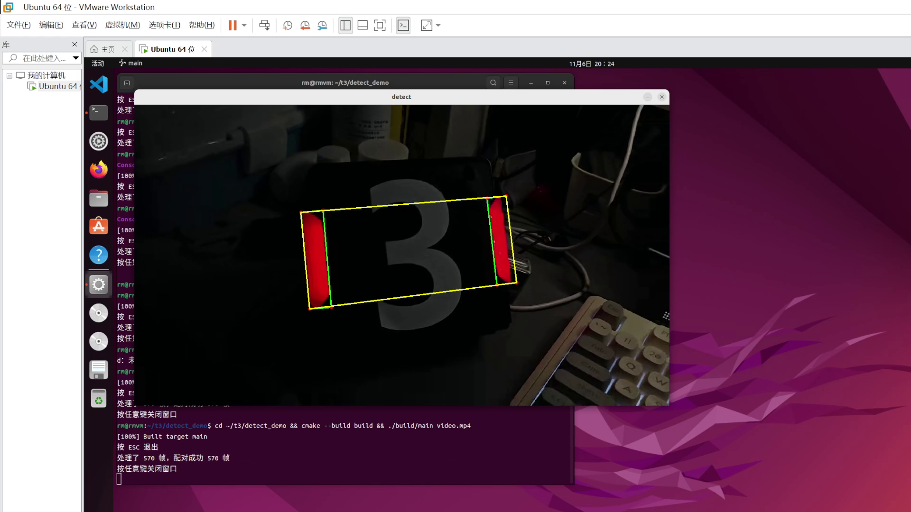

# 培训3

Ubuntu 22.04 + OpenCV 4.5.4，命令行编译。

## hsv_demo（任务1）

读入装甲板图片，转成 HSV，把 H / S / V 拆成三张单通道图分别显示，
再用 `inRange` 提取红色掩膜，存成 `red_mask.png`。

```bash
cd hsv_demo
cmake -S . -B build
cmake --build build
./build/main
```

```
宽: 1043  高: 470
红色像素: 10730
已保存 red_mask.png
```

跑完弹出四个窗口，按任意键关闭。

### 为什么阈值要写两段

红色在色环的接缝上，H 从 0 绕到 179，纯红既落在 0 附近也落在 179 附近。
这张图里两根灯条实测 H = 176~179，只写 `0~10` 一段只能捞到 1038 个像素（基本是噪点），
补上 `170~180` 之后才到 10730。

S / V 的下限 43 / 46 卡在背景和灯条之间：背景 V = 16，灰色数字 V = 45，灯条 V = 247，
对应的 S 分别是 0 / 17 / 248。





## detect_demo（任务2）

`findContours` 找轮廓 → 按面积筛掉反光 → `minAreaRect` 求最小外接矩形 →
按角度和距离把两根灯条配成一对 → 取两条外侧长边连成四边形框住装甲板。

```bash
cd detect_demo
cmake -S . -B build
cmake --build build
./build/main armor.png     # 静态图，弹窗 + 存 result.png
./build/main video.mp4     # 视频，ESC 退出
```

`video.mp4` 就是群里发的素材（1.1 MB），已经放进 `detect_demo/`，clone 下来直接能跑。

运行输出：

```
按 ESC 退出
处理了 570 帧，配对成功 570 帧
按任意键关闭窗口
```





完整运行过程见 [演示视频.mp4](演示视频.mp4)（19 秒，570 帧全部检出）。

### 三个数字都是量出来的

| 判据 | 阈值 | 依据 |
|---|---|---|
| 轮廓面积下限 | 500 | 真灯条 5650 / 4838，反光最大 66，中间空一百倍 |
| 灯条倾角差 | 15° | 相机斜看同一块板，两根实测最大差 13.6° |
| 灯条长度差 | 40% | 实测最悬殊 7% |

### 两个踩过的坑

**① 角度要先折回同一圈。** `minAreaRect` 的 `angle` 和 `size` 不保证哪个是长边，
左边灯条给出 `tilt=177.6`、右边给出 `tilt=-1.1`，数值差 178°，实际只差 1.3°——
两根都是竖直的，只是落在 180° 的两端。先按长边算出倾角，再折进 `[-90, 90)`。

**② 四角不能按 x 排序挑。** 取「x 最小的两个点」当左边那条边，只在灯条接近竖直时成立。
一旦倾角超过 `atan(宽/长)`（这里 `arctan(25.1/165.5) = 8.6°`），长边在水平方向的投影
`L·sinθ` 就超过了宽度的投影 `W·cosθ`，x 最小的两个点会滑到底边上去，
四边形左边只剩灯条宽度那么长，画出来就是个三角形。570 帧里 75 帧中招。
改成按边长识别长边（长度 ≥ 0.8L 的两条），再取左灯条最左那条、右灯条最右那条，全帧正常。
