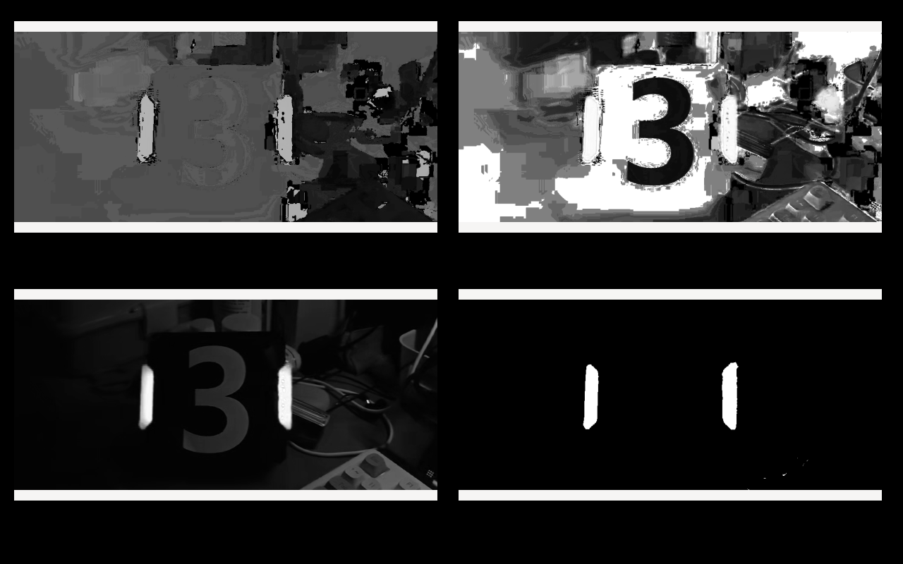
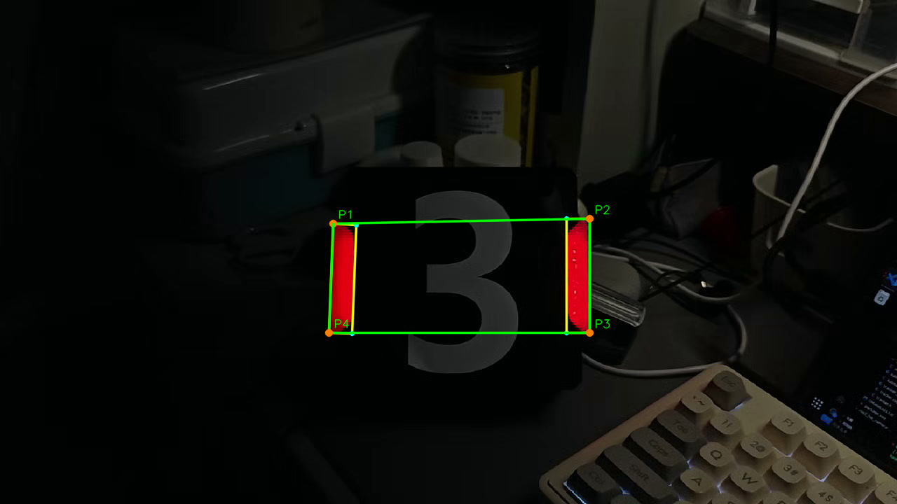

# 培训3


## HSV 与红色掩膜

```bash
cd hsv_demo
cmake -S . -B build
cmake --build build -j4
./build/hsv_demo
```

分别显示 H、S、V 和红色掩膜，按任意键关闭。运行后保存 `red_mask.png` 和三个通道图。
红色取 H 为 0～12、168～179 两段，S 不低于 100，V 不低于 60，再做一次 3×3 闭运算。



图中左上为 H，右上为 S，左下为 V，右下为红色掩膜。

## 灯条和装甲板

```bash
cd detect_demo
cmake -S . -B build
cmake --build build -j4
./build/detect_demo
```

先提取红色轮廓，再用 `minAreaRect` 求灯条矩形，按长宽比、倾角和长度筛选。
灯条从左到右配对，检查长度比、间距和倾角，连接两侧最外面的四个角点。

黄色框表示灯条，青色点表示灯条四角；绿色线连接装甲板四角，橙色点依次标为 P1～P4。
播放时按 Esc 或 q 退出，结果保存为 `result.mp4`。视频输出不含音轨。

```bash
./build/detect_demo test_clip.mp4 result.mp4 --no-show
```




两个程序都支持通过命令行指定输入、输出路径。CMake 会把测试素材复制到构建目录，也可以进入 `build` 后直接运行。
`演示视频.zip` 内有 HSV 窗口录屏、视频识别窗口录屏和完整识别结果。
