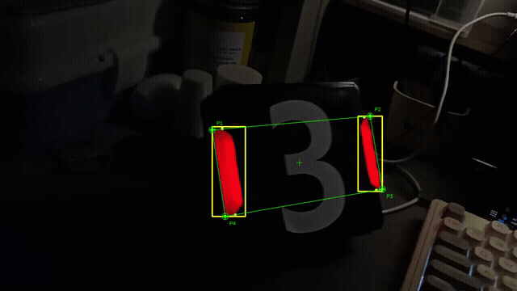
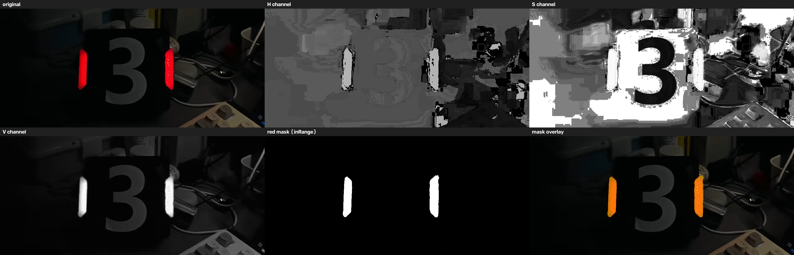
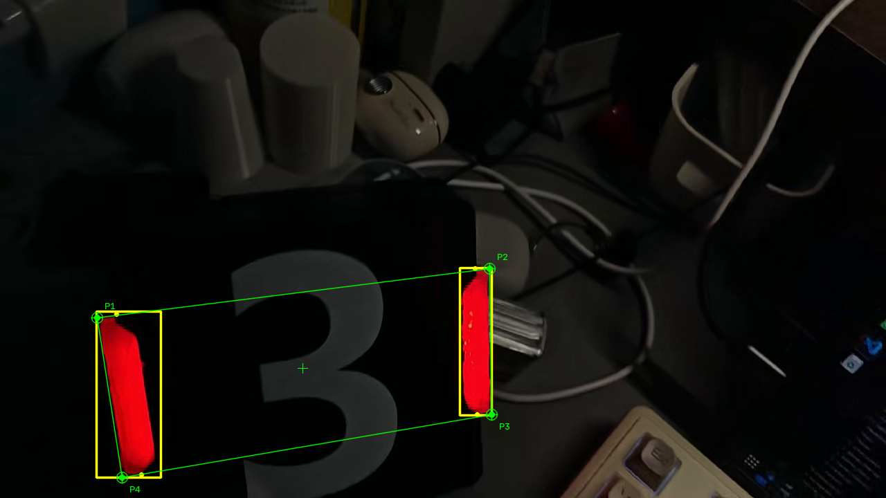

# 作业提交说明（必读）

本仓库是 **征途视觉组培训作业** 的统一提交仓库。

所有作业通过 **Fork + Pull Request（PR）** 的方式提交，**不要**直接往本仓库推代码。

> 每次作业都会在这里更新要求，提交前**先把本文档从头看一遍**，尤其是「注意事项」那一节——上一轮踩过的坑，基本都在里面。

> **重要：一个人只需要一个 PR。** 培训2、培训3、培训4 全部放进同一个 PR，靠文件夹区分，**不要每交一次作业就新提一个 PR**，也不用新建分支。详细说明见 [「提交流程」里的第 6 步](#二提交流程6-步)。

---

## 目录

- [一、目录结构（最重要的规范）](#一目录结构最重要的规范)
- [二、提交流程（6 步）](#二提交流程6-步)
- [三、要上传什么 / 不要上传什么](#三要上传什么--不要上传什么)
- [四、培训3 任务要求（本次作业）](#四培训3-任务要求本次作业)
- [五、注意事项（上一轮踩过的坑，务必看完）](#五注意事项上一轮踩过的坑务必看完)
- [六、常见报错与解决](#六常见报错与解决)
- [七、有问题](#七有问题)
- [八、完整示例（管理者提供，建议先看）](#八完整示例管理者提供建议先看)

---

## 一、目录结构（最重要的规范）

每个人**只有一个**文件夹，命名规则：**年级 + 专业 + 姓名**（用中文），例如：

```
26电科张三/
```

⚠️ **文件夹名必须是中文，不要用拼音、不要用下划线、不要加空格**。
`26_dianke_zhangsan` ❌ `26电科张三` ✅

额外的名字（比如「26机器人」「26计科」「26食质」）按你专业实际写就行，前面两位是入学年份。

所有作业按下面的结构放：

```
仓库根目录/
├── README.md                     ← 本文件，不要改
├── .gitignore                    ← 不要改
│
├── 26电科张三/                    ← 你的文件夹
│   ├── 培训2/
│   │   ├── student_demo/         ← 工程 1
│   │   │   ├── CMakeLists.txt
│   │   │   ├── README.md         ← 你自己的说明（建议写）
│   │   │   ├── includes/
│   │   │   │   └── student.hpp
│   │   │   ├── tools/
│   │   │   │   └── student.cpp
│   │   │   └── src/
│   │   │       └── main.cpp
│   │   └── opencv_demo/          ← 工程 2
│   │       ├── CMakeLists.txt
│   │       ├── main.cpp
│   │       └── test.jpg          ← 测试图片必须一起提交
│   └── 培训3/
│       ├── hsv_demo/             ← 任务 1
│       │   ├── CMakeLists.txt
│       │   ├── main.cpp
│       │   └── armor.jpg         ← 装甲板图片
│       ├── detect_demo/          ← 任务 2
│       │   ├── CMakeLists.txt
│       │   ├── main.cpp
│       │   └── test_clip.mp4     ← 测试视频（截取 10~20 秒的短片段）
│       └── 演示视频.zip           ← 你自己的运行录屏（必须打包成 zip）
│
└── 26机器人李四/                  ← 别人的文件夹
```

**一句话记住：`你的名字/培训N/工程名/`，三层，工程的源代码再往下放。**

上一轮有人把 `student_demo/` 直接放在仓库根目录，结果和别人的路径撞在一起、也没法一眼看出是谁交的——不要在根目录建任何文件夹。

---

## 二、提交流程（6 步）

### 第 1 步：Fork 本仓库

打开 <https://github.com/ZT-Visual-Group-Training/gugugaga> ，点右上角 **Fork** → **Create fork**。

完成后你会有一份自己的副本：`https://github.com/你的用户名/gugugaga`

### 第 2 步：clone 你自己的副本

> ⚠️ 地址里必须是**你自己的用户名**，不是组织的。

```bash
git clone https://github.com/你的用户名/gugugaga.git
cd gugugaga
```

### 第 3 步：按上面的目录结构建文件夹、放代码

### 第 4 步：提交并推送

```bash
git add .
git commit -m "培训3 - 26电科张三"
git push
```

第一次 push 会让你登录 GitHub，按提示走就行。

### 第 5 步：在网页上提 PR

回到网页 `https://github.com/你的用户名/gugugaga`，会看到 **Contribute** / **Compare & pull request** 的黄色按钮，点它：

- 标题写：`培训3 - 26电科张三`
- 说明里写清楚：做了什么、怎么编译、运行结果（贴截图）
- 点 **Create pull request**

到这里就提交完成了。

之后负责人会在 PR 里留言，你按留言改完再 `git push` 一次，**PR 会自动更新，不需要重新提 PR**。

### 第 6 步：以后交新作业，**还是这一个 PR**

> ⚠️ 这一步最多人搞错，一定要看完。

**一个人只需要一个 PR，装下你所有的作业。** 培训2、培训3、培训4……全部放进同一个 PR，靠**文件夹**区分，不靠 PR 区分。

#### ❌ 你不需要做的事

- ❌ 关掉现在的 PR，重新提一个新的
- ❌ 新建一个分支
- ❌ 再 Fork 一次仓库
- ❌ 每交一次作业就提一个新 PR

#### ✅ 你只需要做的事

还是在同一个仓库目录里，该建目录建目录、该放代码放代码，然后：

```bash
git add .
git commit -m "培训3 - 26电科张三"
git push
```

push 完刷新你那个 PR 页面，它会**自动**多出培训3 的文件、commit 数也会变多。**不用点任何按钮。**

你的 PR 最后长这样：

```
26电科张三/
  ├── 培训2/
  │   ├── student_demo/
  │   └── opencv_demo/
  └── 培训3/
      ├── task1_hsv/
      └── task2_armor_video/
```

一个 PR 里同时有培训2 和培训3，**这是完全正常的**，负责人按目录分别看。

#### 为什么是这样？

PR 比较的是「**你这条分支**」和「**组织的 main**」之间的全部差异。只要你一直往同一个分支 push，新内容就会自动并进这个 PR。这是 GitHub 的设计，不是 bug，也不是你操作错了。

#### PR 标题要不要改？

标题会一直停在第一次提 PR 时写的那个（比如「培训2 - 26电科张三」）。想改就点标题右边那个 **Edit**，改成：

```
培训2 + 培训3 - 26电科张三
```

不改也没什么影响，改一下更清楚。

#### 万一不小心提了第二个 PR？

不用慌，也别自己删。在群里说一声，负责人会把重复的那个关掉就行。

**下次记住：一个人一个 PR。**

#### 一句话记住

> **一个 PR = 一个人 = 他所有的作业。目录分层，PR 不分层。**

---

## 三、要上传什么 / 不要上传什么

### ✅ 要上传

- 源代码（`.cpp` / `.hpp` / `.h`）
- `CMakeLists.txt`
- **测试用的图片 / 视频**（不传的话别人拉下来一律跑不起来）
- **演示视频必须打包成 `演示视频.zip`**（培训3 起，详见「注意事项」第 7 条）
- 一份简短的 `README.md`：说明怎么编译、怎么运行（可选但强烈建议）
- 运行结果的截图（可以放在你自己的 `README.md` 里，也可以单独放）

### ❌ 不要上传

- `build/` 之类的编译产物目录
- `.exe` / `.o` / `.a` / `.so` / `a.out` 等二进制文件（编译出来的可执行文件**不要**提交）
- `.vscode/`、`.idea/` 等本地 IDE 配置
- OpenCV 等第三方库的源码
- 压缩包（`.zip` / `.rar` / `.7z`）—— **唯一的例外是演示视频，它必须打包成 zip**
- **对根目录 `README.md` 和 `.gitignore` 的修改**

仓库根目录已经放了 `.gitignore`，上面这些会自动被忽略。

万一还是传上去了也没关系：在 PR 里说一声，或者自己删掉再 push 一次（`git rm -r --cached build`）。

---

## 四、培训3 任务要求（本次作业）

### 前置学习

继续把 OpenCV 没学的学完：

> 【【中文配音】OpenCV C++从零实战：4小时掌握计算机视觉图像处理+3大项目（虚拟画师、文档检测、车牌识别）】
> <https://www.bilibili.com/video/BV1N2Vr6FERw?p=6>

### 任务 1 · HSV 通道分离 + 红色掩膜

**要求**：

1. 读取装甲板图片；
2. 转成 HSV；
3. 分离 H、S、V 三个通道，**分别弹出三个窗口**展示；
4. 写阈值，用 `inRange` 提取**红色装甲**的二值掩膜；
5. 把掩膜保存为 `red_mask.png`。

目录建议 `26XX你名字/培训3/hsv_demo/`。

### 任务 2 · 视频里识别灯条和装甲板

**要求**：用群里发的视频，识别视频中装甲板的**灯条**和它的**四个角点**：

1. 用**最大外接矩形**（`minAreaRect`）框住灯条；
2. 在图像上**显示灯条的四个角点**；
3. **连接装甲板的四个角点**，把整个装甲板框出来。

目标效果（文档里的手绘图）：

```
   ┌───────────────┬──────────────┬───────────────┐
   │  ┌──┐         │              │         ┌──┐  │
   │  │  │  ← 左灯条 │   装甲板「3」  │  右灯条 → │  │  │
   │  └──┘         │              │         └──┘  │
   └───────────────┴──────────────┴───────────────┘
      ↑ 分别用最小外接矩形框住两根灯条，再把最外圈连起来
```

也就是：**两个细长的小框 + 一个包住整体的大框**，每个框的 4 个角点都标出来。

目录建议 `26XX你名字/培训3/detect_demo/`。

> 具体怎么做自己想：颜色怎么取、形状怎么筛、四个角点怎么连起来，都是这次要练的东西。
> 卡住了先去看 [第八节的完整示例](#八完整示例管理者提供建议先看)。

### 培训3 交付物清单

- [ ] 任务 1 的代码（能弹 H / S / V 三个窗口 + 红色掩膜窗口）
- [ ] `red_mask.png`（掩膜文件本身也要提交）
- [ ] 任务 2 的代码（能跑通视频，画出灯条框 + 角点 + 装甲板大框）
- [ ] **运行效果的照片**（截图放进你自己的 `README.md` 或 `shots/` 目录）
- [ ] **运行效果的视频，打包成 `演示视频.zip`**（不接受直接传 mp4，见注意事项第 7 条）
- [ ] 两个工程的 `CMakeLists.txt`
- [ ] 测试用的图片和视频（装甲板图片 + 截短的测试视频片段）

---

## 五、注意事项（上一轮踩过的坑，务必看完）

下面每一条都来自上一轮真实提交里出现的问题，**按出错人数从多到少排**：

### 1. 目录结构错 ❌ 最常见

- 直接放根目录：`opencv_demo/` 放在仓库根 ❌
- 缺「培训N」这一层：`26电科张三/student_demo/` ❌
- 用拼音：`26_dianke_zhangsan/peixun2/` ❌
- 把 `tools/`、`src/` 塞进 `includes/` 里 ❌（`includes/` 只放头文件）

✅ 正确：`26电科张三/培训3/hsv_demo/{CMakeLists.txt, main.cpp, armor.jpg}`

### 2. 文件名大小写 ❌

Linux **区分大小写**，Windows 不区分。这个坑非常隐蔽：

```
CmakeLists.txt    ❌ 在 Windows 上能编过，到 Ubuntu 上直接报
                     "The source directory does not appear to contain CMakeLists.txt"
cmakelists.txt    ❌ 同上
CMakeLists.txt    ✅ 只认这一个拼写
student.HPP       ❌ 和 #include "student.hpp" 对不上
```

同理：你在 Windows 上写的 `#include <Student.hpp>`，如果实际文件名是 `student.hpp`，到 Linux 上就找不到。

### 3. 测试图片 / 视频没提交 ❌

`imread("test.jpg")` 但仓库里没有 `test.jpg` → 别人拉下来能编过，**一运行就 `return -1`，窗口不弹**。

上一轮有同学就是这样：代码完全正确，但评审时跑不起来，只能打回重交。

### 4. 写死绝对路径 ❌

```cpp
imread("/home/mao/gugugaga/26电科温学姐/培训2/opencv_demo/assets/test.png");  ❌
imread("C:/Users/xxx/Desktop/armor.jpg");                                    ❌
imread("armor.jpg");                                                          ✅
imread(argv[1]);                                                              ✅ 更灵活
```

路径只在你自己的电脑上存在，别人一律跑不了。

### 5. 把 `build/`、可执行文件传上去了 ❌

上一轮有人把整个 `build/` 目录（20 多个文件，含 `CMakeCache.txt`、`.o`、`a.out`）提交了。这些东西：

- 换台机器就是废文件，还可能让别人的 CMake 报 `CMakeCache.txt directory ... is different`
- 会把仓库搞得很臃肿

删掉已经提交的文件：

```bash
git rm -r --cached build
echo "build/" >> .gitignore
git commit -m "移除构建产物"
git push
```

### 6. 改了根目录的 `README.md` / `.gitignore` ❌

这两个文件是**全仓库共用**的。十几个人同时改它，合并时必然冲突。

你自己的忽略规则，放到自己的文件夹里（比如 `26电科张三/.gitignore`）。

### 7. 演示视频必须打包成 zip 上传 ❌（培训3 新增）

**规则：演示视频不要直接传 mp4，一律打包成 `演示视频.zip` 再提交。**

```
26电科张三/培训3/演示视频.zip     ✅
26电科张三/培训3/演示视频.mp4     ❌
```

为什么必须打包：仓库里一堆零散的 mp4 很难管理，也分不清哪个是谁的、对应哪次作业；打包后一眼就能看出这是「这份作业的演示视频」，负责人下载也方便。

#### ⚠️ 打包不能把视频变小，所以要先压再打包

**GitHub 的硬限制：单个文件超过 100 MB 直接拒绝；超过 50 MB 会警告。**

zip 只是换个容器，视频本身已经是压缩格式了，**打包前后体积几乎一样**。所以顺序必须是：

> **① 压缩视频 → ② 打包成 zip → ③ 提交**

**第 1 步：把视频压到 100 MB 以内**

- **最省事的办法：截取关键片段**，只保留能看出识别效果的 10~20 秒，用剪映/Pr 导出即可；
- 或者用 ffmpeg 压：

```bash
# 高度降到 720p，crf 越大压得越狠（18~28 之间还能看），-an 去掉音轨
ffmpeg -i 原视频.mp4 -vf scale=-2:720 -c:v libx264 -crf 28 -an 演示视频.mp4
```

**第 2 步：打包成 zip**

```bash
# Windows 上直接右键 →「发送到」→「压缩(zipped)文件夹」也行
zip 演示视频.zip 演示视频.mp4
```

**第 3 步：提交前确认大小**

```bash
ls -lh 演示视频.zip      # Linux / Git Bash
# 或者 Windows 资源管理器里看文件大小
```

**zip 里只放视频**，不要顺手把 `build/`、源代码一起打进去——那些应该直接提交。

> ⚠️ **打包完 `git add .` 发现 zip 没进去？**
>
> 仓库根目录的 `.gitignore` 默认忽略所有 `*.zip`（防止有人把编译产物打成包传上来）。为了演示视频，已经单独给它开了口子：**文件名里带「演示视频」的 zip 会被正常添加**。
>
> 所以请按 `演示视频.zip` 这个名字来命名。如果换了别的名字、`git add` 之后 `git status` 里还是看不到它，强制添加即可：
>
> ```bash
> git add -f 你的文件名.zip
> ```

> 如果实在压不到 100 MB 以内，就别传文件了：把视频传到 B站 / 网盘，在你自己的 `README.md` 里贴链接。

### 8. `using namespace std;` 放头文件里 ❌

```cpp
// student.hpp
using namespace std;      ❌ 会污染所有 include 它的文件
std::string name;         ✅ 头文件里写全 std::
```

`.cpp` 里用 `using namespace std;` 可以接受；头文件里不行。

### 9. 头文件里 `std::string` 漏写 `std::` ❌

```cpp
class Student {
public:
    Student(string name, int score);   ❌ string 找不到（头文件里没有 using namespace std）
    Student(std::string name, int score);  ✅
};
```

上面第 8 条和这条经常一起出现：有人把 `using namespace std;` 删了，但忘了给 `string` 补 `std::`，结果就编不过。

### 10. CMake 的几处小毛病

```cmake
target_link_libraries(main ${OpenCV_LIBS})            ❌ 旧式签名
target_link_libraries(main PRIVATE ${OpenCV_LIBS})    ✅

include_directories(${OpenCV_INCLUDE_DIRS})           ⚠️ 全局生效，能用但不推荐
target_include_directories(main PRIVATE ${OpenCV_INCLUDE_DIRS})   ✅

set(CMAKE_CXX_STANDARD 11)                            ⚠️ 用 17

find_package(OpenCV 4 REQUIRED)                       ❌ 绑死主版本，环境是 5.x 就找不到
find_package(OpenCV REQUIRED)                         ✅ 不绑版本
```

> 上一轮有位同学把 `include_directories` 拼成了 `include_directiories`，CMake 直接报 `Unknown CMake command`，整个工程配置失败。**CMake 报这个错，99% 是函数名拼错了。**

### 11. 学号 / 编号不要用 `int` ❌

```cpp
int id = 00261001;        ❌ 前导零丢失，甚至被当成八进制
std::string id = "00261001";   ✅
```

### 12. 相对路径和「在哪个目录运行」

```cpp
imread("test.jpg");   // 相对的是「当前工作目录」，不是「源码所在目录」
```

- 在 `opencv_demo/` 里运行 → 找 `opencv_demo/test.jpg` ✅
- 在 `build/` 里运行 → 找 `build/test.jpg` ❌

两种解法：

```cmake
# 解法一：CMake 把图片拷到构建目录
file(COPY ${CMAKE_CURRENT_SOURCE_DIR}/test.jpg DESTINATION ${CMAKE_CURRENT_BINARY_DIR})
```

```cpp
// 解法二：支持命令行传路径
std::string path = (argc > 1) ? argv[1] : "test.jpg";
```

### 13. 提交前自检清单

复制走，一项一项对：

- [ ] 目录是 `26XX专业姓名/培训3/工程名/`，全中文
- [ ] 没有把文件夹建在仓库根目录
- [ ] 所有 `CMakeLists.txt` 拼写完全正确（大写 C、大写 M、大写 L）
- [ ] 测试图片 / 视频已经提交进仓库（测试视频用截短的片段，别传整段）
- [ ] 演示视频已经打包成 `演示视频.zip`，且**文件大小 < 100 MB**
- [ ] `git status` 里没有 `build/`、`*.exe`、`.vscode/`
- [ ] 没有改根目录的 `README.md` 和 `.gitignore`
- [ ] 在**全新 clone** 的目录里能 `cmake -S . -B build && cmake --build build` 成功
- [ ] 能通过命令行运行出结果（不是靠 IDE 的运行按钮）
- [ ] 交的是**同一个 PR**（不是新提的），PR 里能同时看到培训2 和培训3 的目录
- [ ] PR 标题写了本次内容，例如 `培训2 + 培训3 - 26电科张三`
- [ ] PR 描述里写了做了什么、怎么编译

---

## 六、常见报错与解决

**Q：push 报 403 / `Permission denied`？**

A：你 clone 的是组织的仓库（`ZT-Visual-Group-Training/gugugaga`）。组织仓库你没有写权限，要 clone **你自己 fork 出来的那份**（`你的用户名/gugugaga`）。

**Q：`CMake Error: The source directory ... does not appear to contain CMakeLists.txt`？**

A：检查文件名大小写，必须是 `CMakeLists.txt`（见注意事项第 2 条）。

**Q：`CMake Error: Unknown CMake command "xxx"`？**

A：函数名拼错了。`include_directiories`、`target_link_libraris` 这类拼写错误最常见。

**Q：`CMakeCache.txt directory ... is different`？**

A：你把别人的 `build/` 目录拷过来了，或者自己换过目录。删掉 `build/` 重新配置：`rm -rf build`。

**Q：`expected ')' before 'name'` / `no declaration matches`？**

A：头文件里的 `std::string` 漏了 `std::`（见注意事项第 9 条）。

**Q：编译能过，但一运行就退出、窗口不弹？**

A：99% 是图片/视频没找到。检查：文件提交了吗？相对路径的当前工作目录对吗？在 `imread` 后面加一句 `if (img.empty()) { cout << "读取失败\n"; return -1; }` 就能立刻看出来。

**Q：`find_package(OpenCV)` 报 `Could NOT find OpenCV`？**

A：OpenCV 没装或者 `OpenCV_DIR` 没配。Windows 上推荐按 <https://github.com/ZT-Visual-Group-Training/gugugaga> 里 README 的「免 VS 安装法」用 MSYS2 装（一条命令搞定 gcc + cmake + opencv）。

**Q：视频处理时程序卡在第一帧？**

A：循环里用了 `waitKey(0)`，改成 `waitKey(1)`。

**Q：push 时报 `File ... is 123.00 MB; this exceeds GitHub's file size limit of 100.00 MB`？**

A：演示视频没压够。先压缩、再打包成 zip（见注意事项第 7 条）。如果已经 push 失败了，先把那个文件撤出暂存区再重来：

```bash
git rm --cached 演示视频.zip      # 或 git rm --cached 演示视频.mp4
git commit -m "移除超大视频"
git push
```

**Q：为什么视频要打包成 zip？直接把 mp4 传上去不行吗？**

A：不行，统一要求打包成 `演示视频.zip`。仓库里零散的 mp4 很难管理，也分不清对应哪次作业、是谁的。注意 **zip 不会让视频变小**，所以要先压到 100 MB 以内再打包。

**Q：我的 fork 落后于原仓库怎么办？**

A：在你 fork 的仓库页面点 **Sync fork** → **Update branch**，然后本地执行 `git pull`。

**Q：已经提过 PR 了还能改吗？**

A：能。改完继续 `git commit` + `git push`，PR 会自动更新，**不用重新提 PR**。

**Q：能不能直接在网页上传文件？**

A：可以（**Add file** → **Upload files**），但不推荐：容易漏文件、路径也容易建错，尤其是多层目录。

**Q：`git commit` 报 `Please tell me who you are`？**

A：一次性配置好身份即可：

```bash
git config --global user.name "你的名字"
git config --global user.email "你的邮箱"
```

---

## 七、有问题

在群里问，或者在 PR / Issue 里留言。

提交前请务必自己**重新 clone 一份**跑一遍——你能跑通，别人不一定能跑通。
---

## 八、完整示例（管理者提供，建议先看）

培训3 的完整实现在 [`示例/培训3装甲板灯条识别/`](示例/培训3装甲板灯条识别/)，
**两个任务都能直接编译、直接跑出结果**，代码带注释，建议先跑一遍再动手写自己的版本。



**示例视频**：[`示例/培训3装甲板灯条识别/演示视频.zip`](示例/培训3装甲板灯条识别/演示视频.zip)（19 秒，1280x720）

| 任务 | 代码 |
|---|---|
| 任务 1 · HSV 分离 + 红色掩膜 | [`hsv_demo/`](示例/培训3装甲板灯条识别/hsv_demo/) |
| 任务 2 · 灯条与装甲板四点 | [`detect_demo/`](示例/培训3装甲板灯条识别/detect_demo/) |

**任务 1 效果**（H / S / V 三个通道 + 红色掩膜 + 红色叠加 + 掩膜上标出的灯条）：



**任务 2 效果**（黄色 = 灯条外接矩形，P1~P4 = 装甲板四个角点，绿色 = 四边形连线）：



```bash
# 任务 1
cd 示例/培训3装甲板灯条识别/hsv_demo
cmake -S . -B build && cmake --build build -j
./build/hsv_demo --show

# 任务 2
cd 示例/培训3装甲板灯条识别/detect_demo
cmake -S . -B build && cmake --build build -j
./build/detect_demo --show
```

示例里踩到的坑（**提交前对照一遍，能省掉大部分打回**）：

1. 灰度阈值 150 在这个暗光视频上几乎失效（570 帧只检出 55 帧），要改 HSV 红色双区间；
2. 红色在 H 上跨 0 度，`0~10` 和 `170~180` 必须取并集；
3. `imread` / `imwrite` 遇到中文路径会静默失败；
4. `cv::VideoWriter` 写出来的视频没有音轨，要声音得用 ffmpeg 再合成；
5. 演示视频先压缩到 100 MB 以内，再打包成 `演示视频.zip`；
6. `.bat` 批处理里不要写中文（cmd 按 GBK 解释 UTF-8 会报一串奇怪的错误）；
7. `putText` 的描边不要用 `thickness=3` 再叠一遍细字，OpenCV 5 下文字末尾会凭空多一个字形。

> 示例**不是标准答案**：阈值、判据、代码结构都按自己的思路写，只要满足第四节的交付物清单就行。
