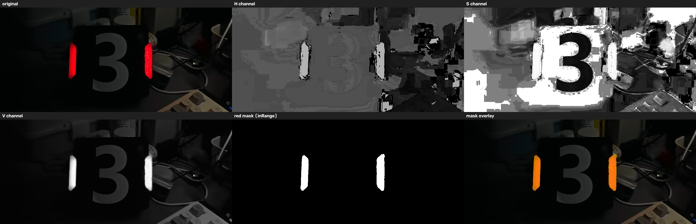
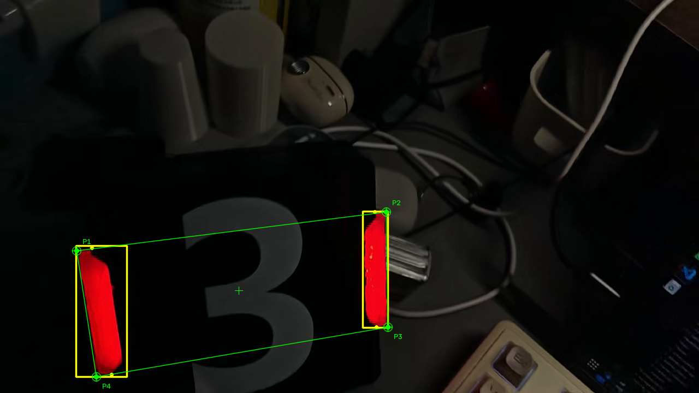
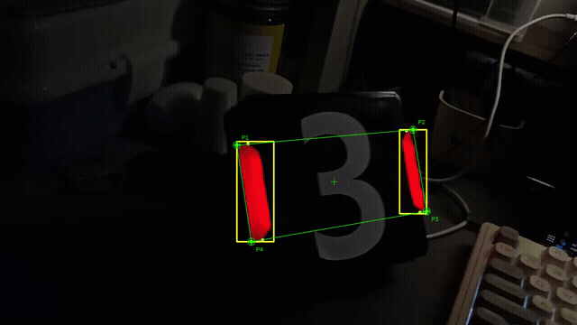

# 培训3 完整示例 · HSV 通道分离 + 红色掩膜 + 视频里的灯条与角点

> 这是**管理者给的参考实例**，不是标准答案。阈值、判据、代码结构都可以按你自己的思路写，
> 只要满足 README 里的任务要求就行。这里的代码能直接编过、直接跑出结果，建议先跑一遍再动手。

## 效果

| 任务 1 · HSV 三个通道 + 红色掩膜 | 任务 2 · 视频里识别灯条和装甲板四点 |
|---|---|
|  |  |

动图（从示例视频里截了 5 秒）：



完整示例视频：`演示视频.zip`（下载解压，19 秒，1280x720）。

## 目录

```
示例/培训3装甲板灯条识别/
├── README.md                  ← 本文件
├── 演示视频.zip               ← 运行录屏（先压再打包，4.7 MB）
├── 效果H-S-V与红色掩膜.png    ← 任务 1 的结果拼图（H/S/V/掩膜/叠加/掩膜上的灯条）
├── 效果视频识别.jpg           ← 任务 2 的一帧
├── 效果预览.gif
├── hsv_demo/                  ← 任务 1
│   ├── CMakeLists.txt
│   ├── main.cpp
│   ├── red_mask.png           ← 跑出来的掩膜
│   └── assets/armor.jpg
└── detect_demo/               ← 任务 2
    ├── CMakeLists.txt
    ├── main.cpp
    ├── src/{armor,detector}.{hpp,cpp}
    └── assets/train3.mp4      ← 测试视频（19 秒短片段，1.2 MB）
```

## 环境

OpenCV 4 或 5 都行（`find_package(OpenCV REQUIRED)`，不绑版本）。Windows 上按 README 里
「免 VS 安装法」用 MSYS2 装最省事：

```bash
pacman -S --needed mingw-w64-x86_64-{gcc,cmake,opencv,make}
```

Linux / Ubuntu：

```bash
sudo apt install build-essential cmake libopencv-dev
```

## 编译运行

### 任务 1

```bash
cd 示例/培训3装甲板灯条识别/hsv_demo
cmake -S . -B build && cmake --build build -j
./build/hsv_demo                # 静默跑，生成 outputs/red_mask.png
./build/hsv_demo --show         # 同时弹出 H / S / V / 掩膜 四个窗口（按任意键关闭）
./build/hsv_demo --image assets/armor.jpg --out .
```

### 任务 2

```bash
cd 示例/培训3装甲板灯条识别/detect_demo
cmake -S . -B build && cmake --build build -j
./build/detect_demo                       # 生成 outputs/train3_demo.mp4 + 统计
./build/detect_demo --show                # 边处理边显示（ESC 退出）
./build/detect_demo --no-connect-corners  # 只画框和角点，不连四边形
./build/detect_demo --hud --stats --mask-inset   # 想看调试信息时打开
```

跑完看 `outputs/train3_demo.mp4`。控制台会打印每帧的平均灯条数 / 装甲板数和检出率，
这份代码在本仓库的测试视频上是：

```
frames: 570    avg lightbars: 2.39    avg armors: 0.99
frames with armor: 559 / 570 (98.1%)   time: 5.5 s (103 fps)
```

> 没有音轨是正常的：`cv::VideoWriter` 只写视频。想要带声音的成片就用 ffmpeg 再合成一次，
> 见下面「踩坑」第 4 条。

## 任务 1 是怎么做的

1. `imdecode` 读图（用 `imread` 也行；这里用 `imdecode` 是为了顺带支持中文路径）；
2. `cvtColor(BGR2HSV)`；
3. `split` 出 H / S / V，分别 `imshow` 三个窗口（`--show` 时）；
4. 红色阈值：HSV 里 H 是 0~180 的环，红色跨 0，所以取两段并集

   ```cpp
   inRange(hsv, Scalar(0,   s_min, v_min), Scalar(10,  255, 255), m1);
   inRange(hsv, Scalar(170, s_min, v_min), Scalar(180, 255, 255), m2);
   bitwise_or(m1, m2, mask);
   ```

   本实例用 `s_min=100, v_min=70`（原视频很暗，V 门槛再高会把灯条吃掉）；
5. `morphologyEx(..., MORPH_CLOSE, 3x3)` 把灯条中间的空洞补上；
6. `imwrite("outputs/red_mask.png", mask)`，另外存了 `red_mask_overlay.png`（红白叠加）
   和 `H/S/V_channel.png` 便于对照。

判据：掩膜里两根灯条是白的、背景是黑的，就说明阈值对了。

## 任务 2 是怎么做的

流程和群里给的骨架一致，只是把每一步都按这个视频的实际亮度调过：

```
读帧 → BGR2HSV → 红色 inRange 两段并集 → 3x3 MORPH_CLOSE
     → findContours(RETR_EXTERNAL) → 每个轮廓 minAreaRect 造灯条
     → 灯条几何判据 → 按 x 排序 → 两两配对成装甲板 → 装甲板几何判据
     → 画黄色轴对齐外接矩形 + 4 个角点 → 连接装甲板四个最外侧角点
```

几个和骨架不一样、但很值得学的地方：

- **灯条判据**（`src/detector.cpp` 里的 `LightbarChecker`）：`angle_error < 45°`、
  `1.5 < 长宽比 < 20`、`length > 8 px`。只看颜色会把画面里所有红色东西都当灯条，
  必须再加形状约束。
- **装甲板判据**：`1 < 两灯条间距/灯条长 < 5`、`两侧灯条长度比 < 1.5`、
  `矩形度误差 < 25°`（两根灯条的倾角和装甲板 roll 角之差）。这三条能把
  「两根不相干的灯条」挡掉。
- **角点取最外侧**：`minAreaRect().points()` 给的 4 个点先按 y 排序，上沿两点里左灯条
  取 x 最小、右灯条取 x 最大，下沿同理。这样连线正好是装甲板的外轮廓，
  如果用灯条端点中点去连，框会往里缩一圈（这个坑我先踩了）。
- **连线顺序**：收集顺序是「左上、左下、右上、右下」，直接按这个顺序连会交叉，
  要重排成 左上→右上→右下→左下（代码里是 `kQuadOrder = {0, 2, 3, 1}`）。
- **视频循环里 `waitKey(1)`**，不要 `waitKey(0)`。

## 参数

| 参数 | 默认 | 说明 |
|---|---|---|
| `--video` | `assets/train3.mp4` | 输入视频 |
| `--out` | `outputs/train3_demo.mp4` | 输出视频 |
| `--dump-every` | 0 | 每隔 N 帧存一张 PNG（排查用） |
| `--no-connect-corners` | - | 不连装甲板四边形 |
| `--hud` | - | 左上角信息面板（帧号/灯条数/装甲板数） |
| `--stats` | - | 装甲板几何参数文字（ratio/side/rect） |
| `--mask-inset` | - | 右下角二值掩膜小窗 |
| `--rotated-outline` | - | 额外画 `minAreaRect` 的旋转轮廓（默认只画轴对齐外框） |
| `--show` | - | 边处理边显示，ESC 退出 |
| `--gray-thresh N` | - | 改用灰度二值化（够亮的环境才有效，见踩坑 1） |

## 踩坑

1. **灰度阈值在这个视频上完全失效**。仓库里传统检测器的 `threshold: 150`，本视频灯条灰度
   只有 86 左右，570 帧里只检出 55 帧（0.12 个装甲板/帧）。改 HSV 红色阈值后是 559 帧
   （0.99 个/帧）。对照数据在 README 的实测表里。
2. **红色跨 0 度**，只写 0~10 会漏掉一半灯条，必须两段并集。
3. **中文路径**：`imread` / `imwrite` 遇到 `D:\桌面\...` 这类路径会静默失败。要么把路径
   换成纯英文，要么用 `imdecode` / `imencode` 绕开（本实例在任务 1 里这么做的）。
4. **`cv::VideoWriter` 没有音轨**，要带声音就用 ffmpeg 把原视频的音轨合进去：

   ```bash
   ffmpeg -y -i output.mp4 -i 原视频.mp4 -map 0:v:0 -map 1:a:0 \
          -c:v libx264 -crf 20 -c:a aac -shortest 演示视频_带声音.mp4
   ```
5. **`.bat` 脚本里不要写中文**：Windows 的 cmd 按 GBK 解释批处理，UTF-8 存的中文注释会
   被拆成乱码命令直接报错。
6. **OpenCV 5 把 `minAreaRect` 挪到了 `opencv2/geometry/2d.hpp`**，只 include
   `opencv2/opencv.hpp` 可能找不到符号；CMake 里还要带上 `opencv_geometry` 模块
   （`find_package(OpenCV REQUIRED)` 的 `${OpenCV_LIBS}` 已经包含，手写 g++ 命令时要补
   `-lopencv_geometry`）。
7. **`putText` 的描边不要用 thickness=3 再叠一遍细字**：OpenCV 5 里这样画，文字末尾会凭空
   多出一个字形。改成「8 邻域各画一次 thickness=1 的黑字，再在中间画一次绿字」。

## 关于「最大外接矩形」再补一句

题目说「用最大外接矩形框住灯条」，本实例画的是 `minAreaRect` 的**轴对齐外接矩形**
（`rotated_rect.boundingRect()`）——它是严丝合缝包住这根斜着的灯条的最小水平矩形，
和手绘图里的效果最像。想看旋转的斜矩形就加 `--rotated-outline`。